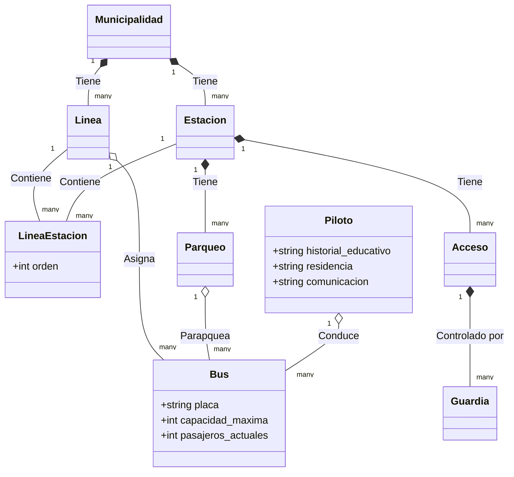

# Arquitectura de Base de Datos - Transmetro

A continuación se presenta el modelo conceptual de las entidades y relaciones generadas con TypeORM para el sistema de control del Transmetro.

## Reglas de Negocio Implementadas:
- **Orden de Ruta**: Resuelto con la tabla intermedia `LineaEstacion`.
- **Alertas de Capacidad (25% / 50%)**: Soportadas matemáticamente por los campos `capacidad_maxima` y `pasajeros_actuales` en la entidad `Bus`.
- **Restricción de Buses**: Pueden no estar asignados a una línea, pero JAMÁS pueden estar sin un parqueo.
